# Windows Forensics 1

**Platform:** TryHackMe    
**Environment:** Kali Linux and Windows  
**Remote Access:** FreeRDP (xfreerdp)  
**Forensic Tool:** Registry Explorer (Eric Zimmerman's EZ Tools)

---

## 1. Introduction

This practical exercise involved investigating a Windows system using its Windows Registry to identify evidence of user activity, application execution, file access and external device connections.

I accessed the Windows investigation machine remotely from my Kali Linux environment using Remote Desktop Protocol (RDP). After establishing the connection, I used Registry Explorer, part of Eric Zimmerman's EZ Tools, to examine the available Windows Registry hives.

The investigation focused on answering six questions in TryHackMe.

## 2. Lab Environment and Initial Access

I started by accessing the TryHackMe Windows Forensics 1 room and obtaining the credentials provided for the Windows investigation machine.

From my Kali Linux terminal, I used FreeRDP (`xfreerdp`) to establish a remote desktop connection.

```bash
xfreerdp /v:<TARGET_IP> /u:<USERNAME> /dynamic-resolution
```

I supplied the credentials provided by TryHackMe to complete the connection.

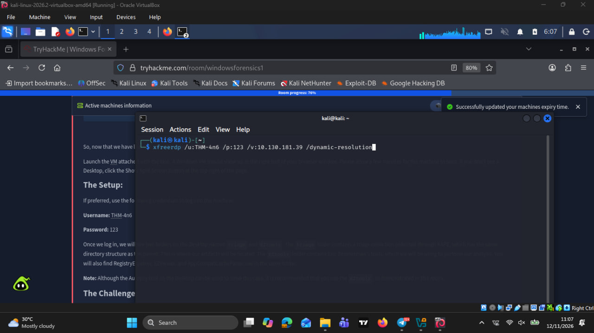

Once the connection was established, the Windows desktop loaded successfully. I could now interact with the Windows environment and access the available files and folders.

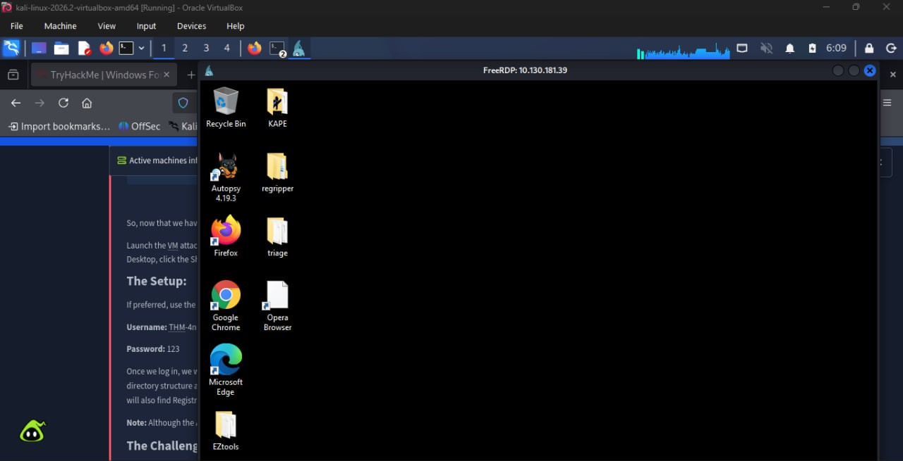

## 3. Loading Windows Registry Hives

I used Registry Explorer to examine the Windows Registry hives.

I navigated to the EZ Tools directory on the Windows machine, located the Registry Explorer application and launched it with administrator privileges.

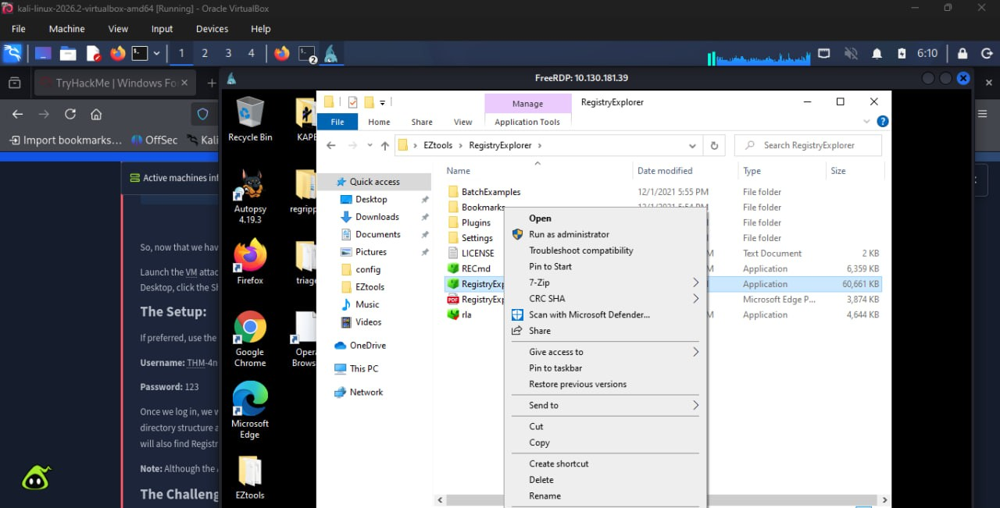

### 3.1 Loading the system registry hives

After launching Registry Explorer, I selected **Load Hive** from the top-left corner of the application.

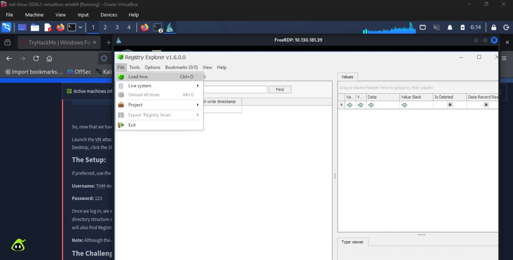

I navigated to the following directory in the image.

This directory contains five important Windows system registry hives:

- DEFAULT
- SAM
- SECURITY
- SOFTWARE
- SYSTEM

I started by selecting the DEFAULT hive without an extension.

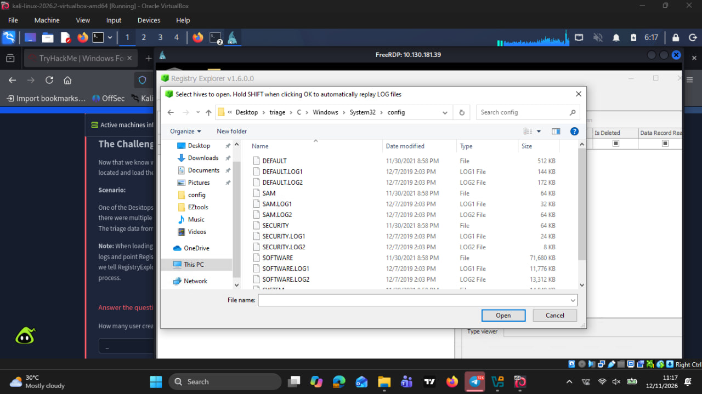

### 3.2 Loading transaction logs

After selecting the DEFAULT hive, Registry Explorer prompted me to select its associated transaction log files.

I selected both:

```text
DEFAULT.LOG1
DEFAULT.LOG2
```

After selecting the logs, Registry Explorer prompted me to choose a location to save the reconstructed hive. I selected the Desktop.

The application then prompted me to load the updated hive, and I selected **Yes**. When asked whether I wanted to load the dirty/original hive, I selected **No**.

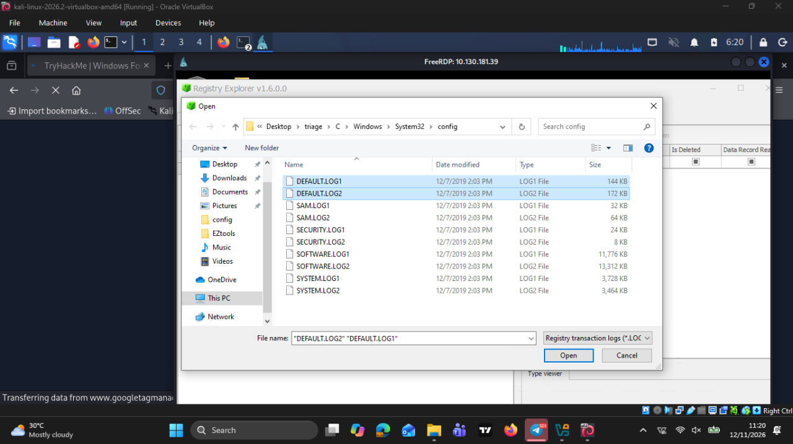

### 3.3 Loading the remaining system hives

I repeated the same procedure for the remaining four system hives:

- SAM
- SECURITY
- SOFTWARE
- SYSTEM

For each hive, I selected its corresponding `.LOG1` and `.LOG2` files, saved the reconstructed hive to the Desktop, loaded the updated version and declined to load the dirty/original version.

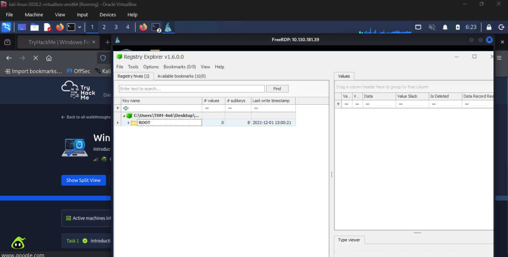

### 3.4 Loading the NTUSER.DAT hive

In addition to the five system hives, I needed to examine information associated with individual user activity which can be done using the NTUSER.DAT hive.

I navigated to the Windows Users directory and located the `NTUSER.DAT` file inside the user profile.

Unlike the system hives, which are stored in `C:\Windows\System32\config`, NTUSER.DAT is stored in an individual user's profile directory.

I loaded this hive into Registry Explorer.

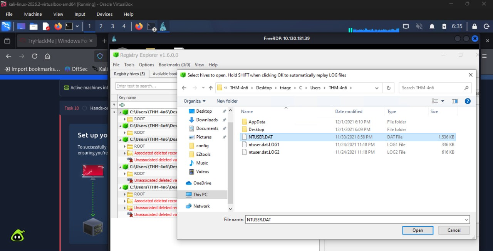

After completing the process, I had six registry hives loaded in Registry Explorer:

1. DEFAULT
2. SAM
3. SECURITY
4. SOFTWARE
5. SYSTEM
6. NTUSER.DAT

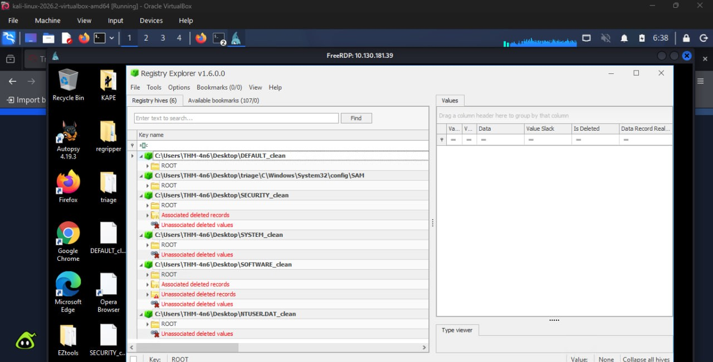

## 4. Investigation and Findings

With the registry hives loaded, I proceeded with the investigation.

Rather than manually expanding the registry tree to locate individual keys, I used the **Available Bookmarks** tab at the top of Registry Explorer.

The bookmarks provided shortcuts to commonly examined forensic registry locations, making it easier to navigate directly to the relevant artefacts.

### 4.1 Identifying user-created accounts

**Question 1: How many user-created accounts are present on the system?**

I selected the SAM hive and used the Available Bookmarks tab to access the USERS section.

The SAM hive contains information about local Windows user accounts, including usernames, relative identifiers (RIDs), login information and password hints.

I examined the User ID section and identified three accounts with RIDs beginning with `10` (the 1000 range).

Windows commonly assigns RIDs starting from 1000 to standard user-created local accounts.

Based on the entries displayed, I identified three user-created accounts.

**Answer: 3 user-created accounts.**

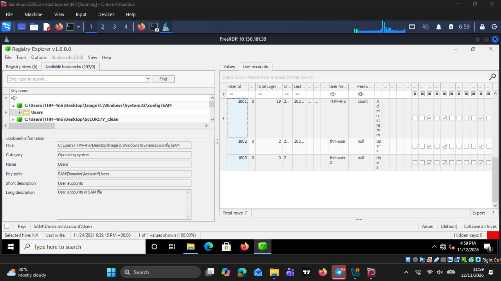

### 4.2 Identifying an account that has never logged in

**Question 2: What is the username of the account that has never been logged in?**

While examining the USERS section of the SAM hive, I inspected the login information associated with the listed accounts.

I identified an account whose Total Login count was zero.

**Answer: `thm-user2`.**

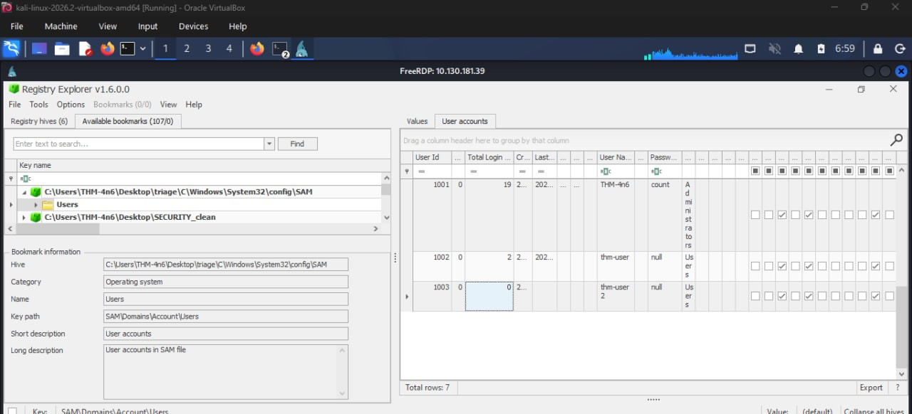

### 4.3 Recovering a user's password hint

**Question 3: What is the password hint for the user THM-4n6?**

I continued examining the user account information within the SAM hive.

I located the entry associated with the THM-4n6 account and inspected its password hint field.

**Answer: `count`.**

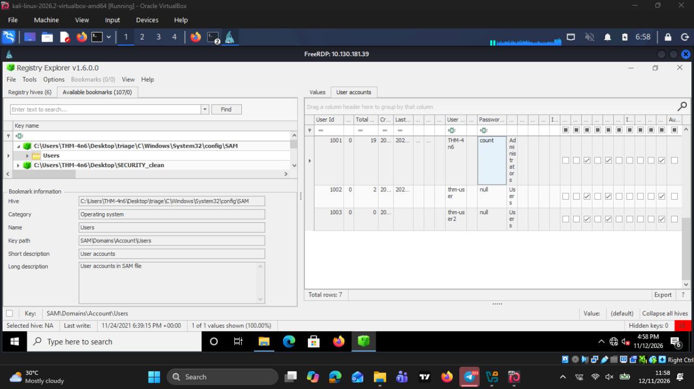

### 4.4 Determining when Changelog.txt was accessed

**Question 4: When was the file Changelog.txt accessed?**

For this question, I switched to the NTUSER.DAT hive.

Using the Available Bookmarks tab, I accessed the RecentDocs registry artefact.

RecentDocs contains info about recently opened files and folders associated with a Windows user.

I examined the entries and located `Changelog.txt`.

I then inspected the Last Opened information displayed by Registry Explorer to determine the timestamp associated with the file activity.

**Answer: `2021-11-24 18:18:48`.**

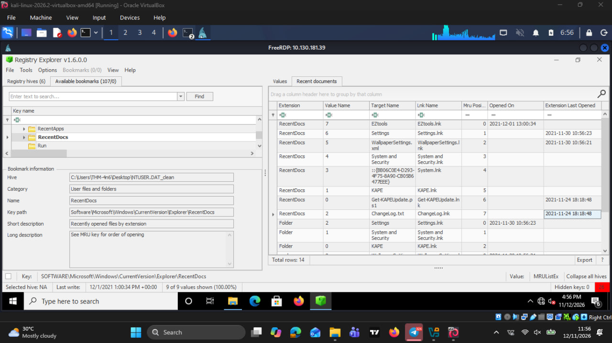

### 4.5 Identifying the execution path of Python

**Question 5: What is the complete path from where the Python 3.8.2 installer was run?**

For this question, I continued using the NTUSER.DAT hive.

Using the Available Bookmarks tab in Registry Explorer, I navigated to the RecentApps artefact to examine application-related activity.

I searched through the available entries and located the Python 3.8.2 installer.

After examining the associated information, I identified the path from which the installer was run.

**Answer:**

```text
Z:\setups\python-3.8.2.exe
```

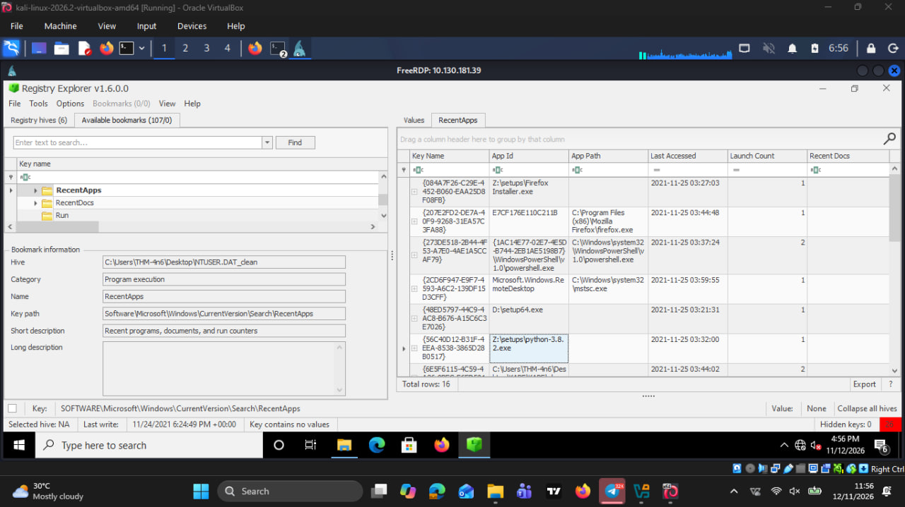

**Note:** This was the approach I followed during the practical exercise. Although I was able to identify the required path, I would recommend exploring other Windows execution artefacts such as UserAssist to understand how different registry artefacts record application activity.

### 4.6 Investigating USB device connection history

**Question 6: When was the USB device with the friendly name USB last connected?**

For the final question, I switched to the SYSTEM hive.

Using the Available Bookmarks tab, I accessed the USBSTOR registry artefact.

USBSTOR stores information about USB mass-storage devices previously connected to a Windows system.

I examined the available device entries and identified the entry associated with the USB device under investigation.

I saw the related timestamp information displayed to establish when the device was last connected.

**Answer: `2021-11-24 18:40:06`.**

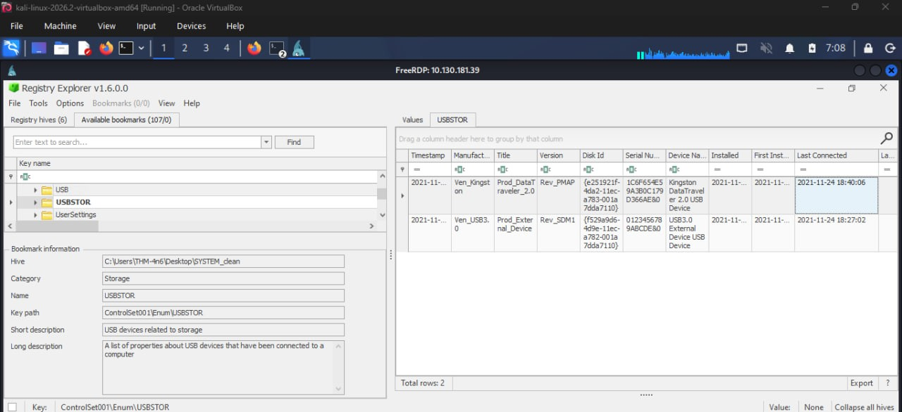

## 5. Challenges Encountered

One of the main challenges I encountered was loading the registry hives correctly into Registry Explorer.

The process required some attention because the hive files had associated transaction logs that also needed to be selected.

I had to understand the prompts presented by Registry Explorer, particularly the options for loading the updated hive and whether to load the dirty/original hive.

Another challenge was understanding which registry hive contained the information required to answer each investigation question.

The SAM, SYSTEM and NTUSER.DAT hives contained different categories of information, so knowing which hive to examine was important.

Using the Available Bookmarks feature made the investigation easier by providing shortcuts to relevant registry locations without manually navigating through the entire registry tree.

## 6. Lessons Learned

This practical exercise helped me develop a better understanding of Windows Registry forensics.

Some of the key things I learned include:

- How to access a Windows investigation machine remotely from Kali Linux using RDP.
- How to locate and load offline Windows Registry hives into Registry Explorer.
- The importance of transaction logs when reconstructing registry hive data.
- How different Windows Registry hives contain different categories of forensic evidence. Knowing where to look and how to interpret the available information is crucial when investigating user and system activity.
- How Registry Explorer's Available Bookmarks feature simplifies navigation during forensic investigations.
